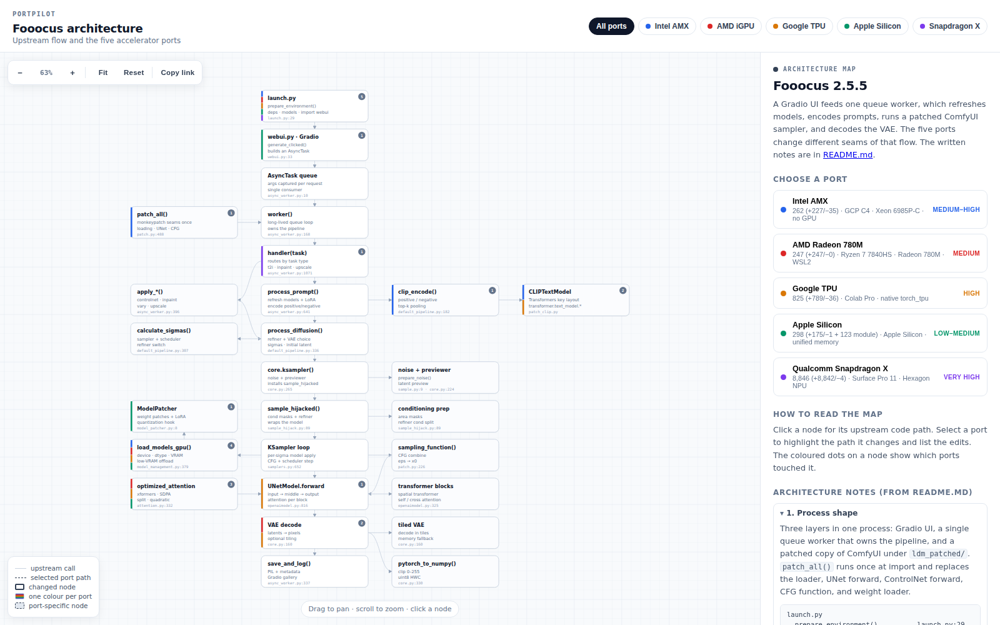
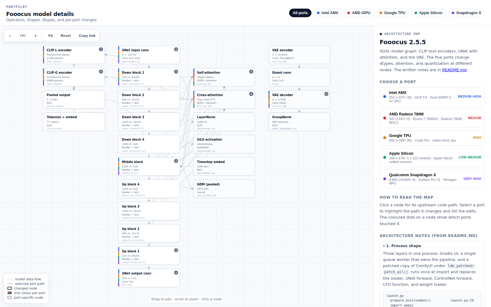

# portpilot

**Using AI agents to port GPU code** — a pilot on porting AI code on semi-autopilot.

High-end datacenter GPUs are a popular platform for AI workloads, but they are not widely available to consumers and enterprise. This repo tests whether AI agents can port real AI applications to more commonly accessible hardware — Gaming GPUs, AI PCs, laptops, CPUs, and TPUs — and where a human still needs to step in. Anthropic recently showed that agents can [semi-automatically port code][anthropic]; this is a practical follow-up on real apps.

The goal is a **minimum viable port**: the app runs and produces correct output, not deep feature parity or performance tuning. [Fooocus](https://github.com/lllyasviel/Fooocus) is the first app tested.

## At a glance

- **Five hardware targets, one app, about a day each.** Fooocus runs on Intel AMX, AMD ROCm, Google TPU, Apple Silicon, and a Qualcomm NPU.
- **The hard part was not kernel programming.** Dependency drift and silent fallbacks caused most issues; vendor knowledge and correctness checks still needed a human.
- **Memory is the binding constraint, not raw compute.** Weight quantization buys capacity; better attention would buy headroom.
- **The playbook is reusable.** The lessons are packaged as [OpenCode skills](.opencode/skills/) and summarized in [`skills.md`](skills.md).

## Approach

LLMs are widely used and commonly vendor-optimized, so this repo targets code that is *not* already tuned for every platform, such as image and video generators. We use [OpenCode](https://opencode.ai) with free models — Big Pickle, Beam Free, and Iceman — and escalate to DeepSeek or Claude only when they stall.

This is **not** a comparison of model capability. We are looking for the most accessible path to a working port; a model is useful here if it gets the app running, regardless of how it ranks against others.

## Results

Each experiment took about a day of effort.

| Target | Result | Lines changed | Difficulty | Links |
| --- | --- | --- | --- | --- |
| **Intel AMX** (CPU) — GCP C4, Xeon 6985P-C | bf16 autocast dispatched AMX kernels; SD1.5 256², 4 steps **2.2 s** (vs 3.3 s baseline); SDXL 512², 4 steps **8.6 s**; CLI and Gradio | 262 (+227/−35) | Medium–high | [Write-up](fooocus/Intel_AMX/README.md) · [Patch](fooocus/Intel_AMX/fooocus-amx.diff) · [Script](fooocus/Intel_AMX/fooocus-amx.sh) |
| **AMD Radeon 780M** (iGPU) — WSL2, Ryzen 7 7840HS | ROCm 7.2.4 + PyTorch 2.14.1 with a `gfx1100` override; **4.1 TFLOPS** fp16 | 247 (+247/−0) | Medium | [Write-up](fooocus/AMD_iGPU/README.md) · [Patch](fooocus/AMD_iGPU/fooocus-rocm.diff) · [Setup](fooocus/AMD_iGPU/setup-fooocus-amd.sh) |
| **Google TPU** — Colab Pro, native `torch_tpu` | No `torch_xla`; 1024² 30-step images; 1152×896 **1.3–2.6 it/s** after ~90 s first-shape compile; **15.0 GiB** peak HBM | 825 (+789/−36) | High | [Write-up](fooocus/Google_TPU/README.md) · [Patch](fooocus/Google_TPU/fooocus_tpu_patch.diff) · [Script](fooocus/Google_TPU/fooocus-tpu.sh) |
| **Apple Silicon** (MPS) — Mac, unified memory | MPS with NF4 int4 UNet (**~3.8×** smaller weights); live resource meter; runs, but no benchmark captured | 298 (+175/−1 + 123-line module) | Low–medium | [Write-up](fooocus/Apple_Silicon/README.md) · [Patch](fooocus/Apple_Silicon/changes.diff) · [Quantization](fooocus/Apple_Silicon/quantization.py) · [Setup](fooocus/Apple_Silicon/setup_and_run.sh) |
| **Qualcomm Snapdragon X** (NPU) — Surface Pro 11 | x64 UI + native ARM64 QNN process; w8a16 UNet; SDXL 1024², 8 steps **~22 s warm**; SD 2.1 **2.9 s**; inpaint **26.4 s** | 8,846 (+8,842/−4) | Very high | [Write-up](fooocus/Qualcomm_Snapdragon/README.md) · [Patch](fooocus/Qualcomm_Snapdragon/fooocus_snapdragon_win.diff) · [Script](fooocus/Qualcomm_Snapdragon/run_snapdragon.bat) |

**Lines changed** = added + removed across each port patch; Apple Silicon also ships a separate 123-line `quantization.py` (175 + 123 = 298). **Difficulty** estimates integration and debugging risk, not elapsed time; all five took about a day of agent-assisted effort. Snapdragon's patch includes ~6.9k lines of vendored `npu/sdxl` pipeline code, leaving ~2k lines of port glue.

## Architecture

Fooocus is a Gradio UI, a single queue worker, and a patched copy of ComfyUI's
model and sampling code. Most ports change a few seams — device selection, dtype,
attention, CLIP loading — rather than the model code. The exception is Snapdragon,
which reroutes supported requests to a separate ARM64 NPU process.

- [Architecture notes](fooocus/architecture/README.md) — module map, request path, sampling loop, and a per-port overlay.
- [Interactive architecture diagram](fooocus/architecture/architecture.html) — zoom, pan, click a node for its upstream code path, and pick a port to highlight its changes:
  [Intel AMX](fooocus/architecture/architecture.html#port=amx) ·
  [AMD iGPU](fooocus/architecture/architecture.html#port=amd) ·
  [Google TPU](fooocus/architecture/architecture.html#port=tpu) ·
  [Apple Silicon](fooocus/architecture/architecture.html#port=apple) ·
  [Snapdragon X](fooocus/architecture/architecture.html#port=snap).

The interactive version of the same map is in [`architecture.html`](fooocus/architecture/architecture.html): drag to pan, scroll to zoom, click a node for its upstream code path, and pick a port in the top bar to highlight the path it changes.
- [Model details](fooocus/architecture/model_details.html) — operators, weight/activation shapes and dtypes, and where each port changed the model.

## What worked

- **Use the backend's existing fast path.** bf16 autocast let oneDNN select AMX kernels without IPEX; PyTorch SDPA covered attention; vendor overrides unlocked unsupported GPUs.
- **Patch at the seams, not in the model.** `modules/patch.py` and `model_management.py` covered UNet/VAE/CLIP without forking Fooocus.
- **Fit memory deliberately.** NF4 int4 on the Mac, w8a16 on the NPU, a lazy fallback pipeline, and tiled VAE.
- **Prove the accelerator is used.** Compare state-dict keys, check kernel counters, and disable CPU fallback so unsupported ops fail loudly instead of silently running on the CPU.

## What did not go as planned

- **Dependency drift caused the worst bugs.** Transformers 5 silently loaded zero CLIP weights on TPU, producing NaN conditioning and black images. numpy 2 and Python 3.13 removed APIs Fooocus relies on. Gradio 3.41.2 needed old FastAPI/Pydantic/Starlette pins on macOS and Windows ARM64.
- **Unsupported paths fail silently or need a shim.** `gfx1103` has no rocBLAS kernels, so ROCm needs a `gfx1100` override; QNN registration via `providers=[...]` fell back to CPU; xformers has no ARM64 wheel.
- **Architecture and memory limits dominate the rest.** WSL advertises 25.6 GB of shared GPU memory on a 7.7 GB VM; SDXL's ~26 GB footprint exceeds a 16 GB Mac; the x64-emulated UI cannot load the ARM64 QNN library, forcing a two-process split.
- **Cosmetic choices still need a human.** The agent picked arbitrary colors for the architecture diagram; vendor-conventional colors (Intel blue, AMD red, NVIDIA green, Qualcomm purple, Apple green) had to be chosen and fixed by hand.

Full bug logs: [Intel AMX](fooocus/Intel_AMX/README.md#bugs-encountered--resolutions) · [AMD iGPU](fooocus/AMD_iGPU/README.md#7-bugs-encountered-and-resolutions) · [Google TPU](fooocus/Google_TPU/README.md#4-debug-log-symptom--cause--fix) · [Apple Silicon](fooocus/Apple_Silicon/README.md#known-limitations) · [Snapdragon](fooocus/Qualcomm_Snapdragon/README.md#troubleshooting).

## How the work went

The AI was generally able to complete a functional port on its own, but it
sometimes ran into validation errors where there were silent failures — a model
that loaded zero weights, a kernel that quietly fell back to the CPU, a UI that
served HTTP 200 while generation never finished. A human had to flag these
errors, but the AI debugged them once pointed at the right layer.

In many cases memory was tight, and the AI was able to suggest several paths
forward, including weight streaming and offload. A human had to guide the AI on
quantization — including evaluating the accuracy tradeoff of each approach — but
the AI ran the testing for accuracy loss against dummy inputs.

An expert human reviewer also provided guidance on paths forward, such as using
different SDKs and approaches. These suggestions have been absorbed into the
porting skill, and future tests will see whether the AI is able to apply these
skills automatically.

To better understand the work, we asked the AI to draw detailed model
architecture and flow diagrams and highlight where changes were made — see the
[Architecture](#architecture) section and
[`fooocus/architecture/`](fooocus/architecture/).

## Tests that would have caught these bugs

Each issue below was found by hand. A short, repeatable check would have
surfaced most of them earlier. Run this set before calling a port working; the
same tests are packaged in the [`porting-verification` skill](.opencode/skills/porting-verification/SKILL.md).

| Test | What it catches | Where it would have helped |
| --- | --- | --- |
| **Checkpoint key audit** — diff checkpoint keys against `state_dict`, print matched/missing counts, fail if nothing loaded | `strict=False` masking a layout change; `no_init_weights()` leaving parameters uninitialised | [TPU CLIP](fooocus/Google_TPU/README.md#35-clip-under-transformers-5--the-real-blocker) · [AMX](fooocus/Intel_AMX/README.md#bugs-encountered--resolutions) |
| **Finite-conditioning audit** — `torch.isfinite` on `c_crossattn`, `pooled_output`, ADM, and the first latent | NaN conditioning and black images with no exception | [TPU](fooocus/Google_TPU/README.md#4-debug-log-symptom--cause--fix) |
| **Random-weight control** — build the same model from random weights and compare finiteness | Separates a loading problem from a compute problem | [TPU](fooocus/Google_TPU/README.md#4-debug-log-symptom--cause--fix) |
| **Non-flat image check** — mean/std and histogram of the saved PNG; assert std above a floor | A pipeline that runs but emits black or flat output; a missing checkpoint behind an HTTP 200 UI | [AMD](fooocus/AMD_iGPU/README.md#bug-9--missing-checkpoint) · [TPU](fooocus/Google_TPU/README.md#52-full-pipeline-generation) |
| **Accelerator-usage proof** — print `torch.accelerator` and device type, check kernel counters (`ONEDNN_VERBOSE`, `processwatch`), disable CPU fallback | Silent CPU fallback; QNN `providers=[...]` falling back; an incorrect device selected | [Snapdragon](fooocus/Qualcomm_Snapdragon/README.md#the-one-runtime-detail-that-matters-most) · [AMX](fooocus/Intel_AMX/README.md#verification) |
| **Real-allocatable memory probe** — allocate until OOM, or compare driver-reported memory with runtime-usable memory | WSL's 25.6 GB shared VRAM on a 7.7 GB VM; a 4 GB UMA carve-out; SDXL's ~26 GB on a 16 GB Mac | [AMD](fooocus/AMD_iGPU/README.md#bug-8--wsl-reports-2557-gb-vram-but-only-has-77-gb-ram) · [Apple](fooocus/Apple_Silicon/README.md#known-limitations) |
| **Cold-vs-warm timing** — time the first request and a repeated request separately, logging peak memory | Compile time mistaken for per-step speed; a 60–90 s NPU context load | [TPU](fooocus/Google_TPU/README.md#6-performance-notes) · [Snapdragon](fooocus/Qualcomm_Snapdragon/README.md#timing-model) |
| **Core-op dtype ladder** — matmul, SDPA, conv, norm, and SiLU at the target dtype; assert output dtype | bf16→NumPy conversion failures; CUDA-only autocast; missing `std_mean` on MPS/TPU | [TPU](fooocus/Google_TPU/README.md#4-debug-log-symptom--cause--fix) · [Apple](fooocus/Apple_Silicon/README.md#known-limitations) |
| **Dependency dry-run** — build the environment in a throwaway venv, then diff installed versions against the accelerator stack | `pip` downgrading numpy or `torch_tpu`; the ROCm index shadowing PyPI; a missing `pip` in a `uv` venv | [TPU](fooocus/Google_TPU/README.md#4-debug-log-symptom--cause--fix) · [AMD](fooocus/AMD_iGPU/README.md#bug-5--uv-resolves-an-incorrect-tqdm) |
| **UI worker end-to-end** — drive the app's own queue and assert `process_completed success=True` plus a non-flat gallery image | A UI that serves HTTP 200 while generation never finishes; a websocket timeout on the first step | [AMD](fooocus/AMD_iGPU/README.md#bug-9--missing-checkpoint) · [TPU](fooocus/Google_TPU/README.md#54-gradio-end-to-end) · [Snapdragon](fooocus/Qualcomm_Snapdragon/README.md#wire-protocol) |
| **Feature-coverage matrix** — list text-to-image, inpaint, upscale, enhance, ControlNet, and refiner; mark each tested or fallback | Unwired paths reported as working; silent CPU fallback for unsupported tasks | [Snapdragon](fooocus/Qualcomm_Snapdragon/README.md#limits) · [TPU](fooocus/Google_TPU/README.md#7-known-limitations--follow-ups) |

Cheapest first: import → device probe → key audit → finite audit → one image → UI
queue → timing. If any step fails, stop; do not tune performance yet.

Each check should leave a command and a saved log in the port's write-up, plus a
regression test where the issue was silent.

## Where better attention would help

| Port | Memory headroom | Impact | Why |
| --- | --- | --- | --- |
| **AMD Radeon 780M** | 7.7 GB WSL RAM; 4 GB UMA carve-out | **Highest** | Low-VRAM offload is forced; AOTriton already ships `amd-gfx110x` flash-attention kernels. |
| **Google TPU** | ~15.0 of 15.75 GiB HBM used | **Moderate–high** | SDPA is already fused; the gain would come from chunked attention or tiled decode. |
| **Apple Silicon** | ~26 GB SDXL footprint vs unified memory | **Moderate** | NF4 cuts weights ~3.8×; attention memory still matters at high resolution. |
| **Snapdragon X** | 16 GiB unified; NPU set ~4.36 GB | **Limited** | Attention is fixed at compile time; the UNet is dispatch-limited, not memory-limited. |
| **Intel AMX** | 60 GB system RAM | **Limited** | Memory is not the constraint; the 4-core CPU is compute-bound. |

## Broader dependency study

To understand the porting landscape beyond Fooocus, we also ran an experiment to
survey the software dependencies across a collection of AI apps — what they pull
in and how those dependencies constrain portability to different hardware. We
used [Pinokio](https://github.com/pinokiofactory) as the source collection because
it is a broad set of usable AI apps targeting multiple platforms. The
autogenerated results are in [`pinokio-apps/`](pinokio-apps/README.md), including
a per-app table of platform support, dependencies, CUDA-only packages, and
estimated porting difficulty.

## A note from the author

Although I have deep experience across AI, systems software, programming, and academia, AI has made my job much more productive. This experiment has lifted my spirits about what lies ahead in computing. At the same time, humans are still needed to ideate, solve hard design issues, provide domain expertise, guide the AI, and validate correctness.

## Acknowledgments

This analysis would not have been possible without the work of the projects and
vendors behind it. Thank you to:

- **Fooocus** — [lllyasviel/Fooocus](https://github.com/lllyasviel/Fooocus) and its
  maintainers, for a self-contained, hackable diffusion app and the patched
  ComfyUI stack it ships.
- **PyTorch** — for the portable tensor runtime, autograd, and the SDPA,
  autocast, and quantization primitives that every port leans on.
- **Diffusers / Hugging Face** — for the model and pipeline ecosystem, CLIP
  weights, and the reference implementations we ported against.
- **Vendors** — Intel (AMX, oneDNN, IPEX), AMD (ROCm, AOTriton), Google
  (native `torch_tpu`, PJRT), Apple (MPS, Metal), and Qualcomm (QNN, Hexagon
  HTP) — for the accelerator stacks, kernels, and tooling that make these ports
  feasible, often on hardware the vendors never officially targeted.
- **Supporting libraries** — ONNX Runtime, Gradio, Transformers, NumPy, and the
  many small utilities in between.
- **OpenCode** — for the agent harness, tooling, and the skill system that made
  this semi-automated porting experiment practical.
- **Model providers** — for the free and widely available models that drove the ports
  (Big Pickle, Beam Free, Iceman, and others), plus DeepSeek and Claude for the
  harder cases.

Any bugs or rough edges in these write-ups are ours; the underlying work is theirs.

## Try it on your hardware

We are happy to try porting to your hardware if you can provide access for a few days. Just email [emchan.aicoding@gmail.com](mailto:emchan.aicoding@gmail.com) or connect on [LinkedIn](https://www.linkedin.com/in/emchan/).

## Disclaimer

This project is for **educational and demonstration purposes only**.

- The ported code may contain bugs and has **not** been deeply validated beyond basic functionality.
- Some of the code runs into out-of-memory conditions and corner-case bugs.
- Each upstream project retains its **original license**; this repo does not relicense any third-party code.
- Any patches provided here are applied on top of the existing upstream code for demo purposes only and are not intended for production use.
- The README for each project was AI-generated and then human-edited, so details may be incomplete or inaccurate.

Use at your own risk.

[anthropic]: https://finance.yahoo.com/technology/ai/articles/anthropic-model-taught-itself-run-160952316.html
